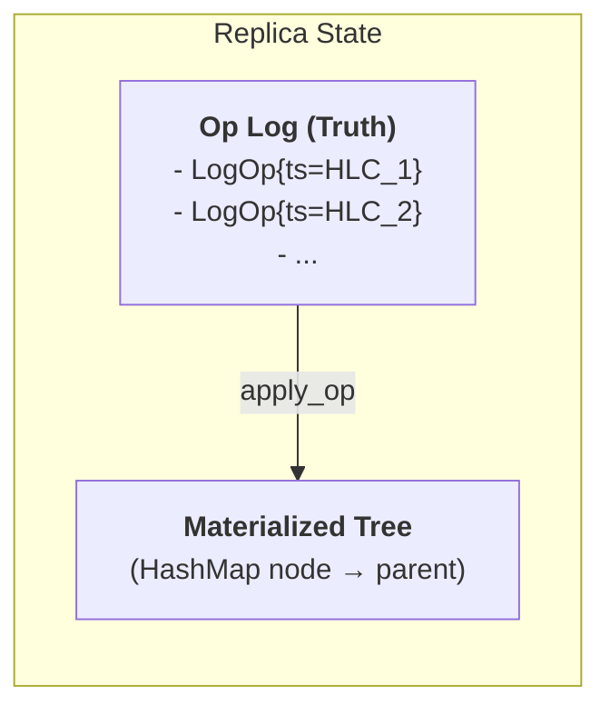
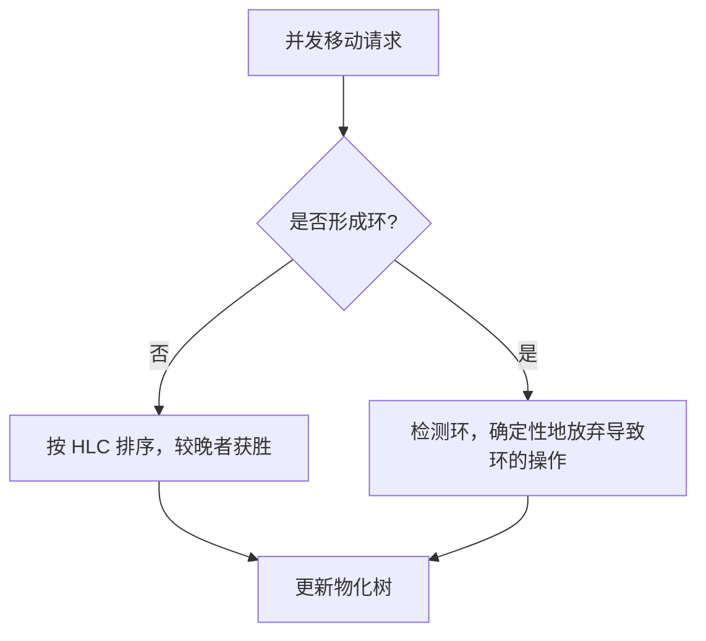
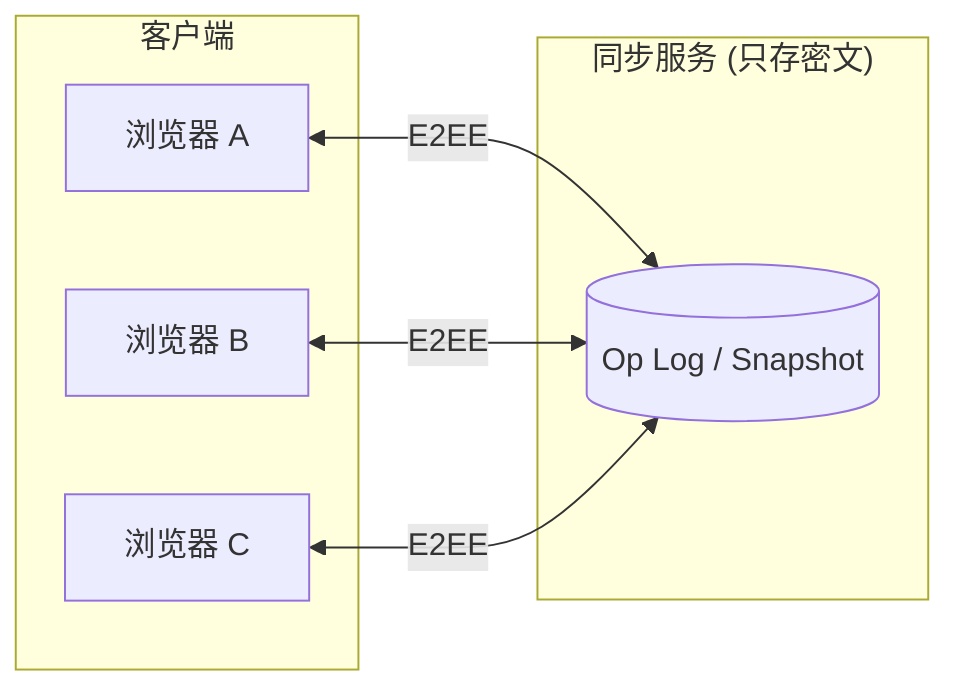
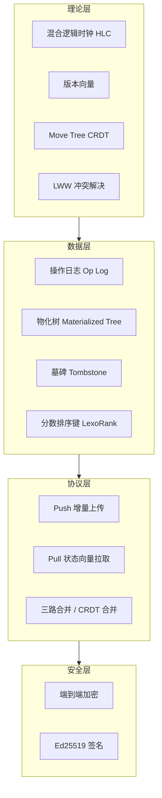

要构建一个“最完善”的书签同步方案，需要从分布式系统的理论高度来设计。核心结论是：**以 Kleppmann 的 Move Tree CRDT 算法为理论基石，配合混合逻辑时钟（HLC）、操作日志（Op Log）和状态向量（State Vector），可以构建一个无中心协调、最终一致且能正确处理树结构并发移动的同步系统。**

下面是一份系统性的理论方案。

---

## 📐 形式化基础与核心理论

### 🔄 状态同步 vs 操作同步 vs CRDT

三种同步策略的对比如下：

| 策略 | 原理 | 优点 | 缺点 | 适用场景 |
|------|------|------|------|----------|
| **状态同步** | 同步整个数据对象最终状态 | 实现简单 | 网络开销大，冲突难解 | 小型、低频数据 |
| **操作同步** | 同步导致状态变化的操作 | 增量小 | 需严格顺序，离线场景难 | 在线协作 |
| **CRDT** | 特殊数据结构，任意顺序应用操作均收敛 | 天然支持离线、无中心 | 元数据开销、实现复杂 | **离线优先、多端同步** |

书签同步属于典型的**离线优先（Offline-First）** 场景——用户可能在多个设备上离线修改书签，网络恢复后需要自动合并。CRDT 的设计保证了“在任何副本上、以任何顺序应用操作，最终所有副本都能收敛到相同状态”，完美契合这一需求。

### 🕰️ 混合逻辑时钟（HLC）

书签同步需要为每个操作分配一个**全序、单调递增**的时间戳。单纯使用物理时钟（Wall Clock）会因 NTP 同步导致时钟回拨，单纯使用 Lamport 逻辑时钟则无法反映真实时间。

**混合逻辑时钟（HLC）** 将两者结合，结构为 `{ wallMs, counter, nodeId }`：物理毫秒时间戳 + 逻辑计数器 + 节点标识。HLC 保证：

- **单调递增**：即使物理时钟调整，逻辑计数器也能保证时间戳不回退。
- **因果一致性**：如果事件 A 因果先于 B，则 `HLC(A) < HLC(B)`。
- **全局唯一**：`(HLC, nodeId)` 组合全局唯一。

HLC 是操作日志全序排序的基础，也是 LWW（Last-Write-Wins）冲突解决的时间依据。

### 🧬 版本向量（Version Vector）

版本向量是一个 `Map<PeerId, Counter>`，记录每个对等节点已贡献的操作数量。它的核心作用是**判断两个操作之间是否存在因果关系**：

- 如果 `VV(A) < VV(B)`，则 A 是 B 的祖先，存在因果顺序。
- 如果两个版本向量不可比较，则操作是**并发**的，需要冲突解决。

版本向量用于**增量同步**：客户端将自己的版本向量发给服务端，服务端据此计算出客户端缺失的操作。

### 🗃️ 操作日志（Op Log）与物化状态

系统维护两个核心状态：

1. **Op Log（操作日志）**：追加写入、由 HLC 全序排列的操作序列。这是**权威数据源（Truth）**。
2. **Materialized Tree（物化树）**：从 Op Log 通过 `apply_op` 派生的 HashMap 结构（`node → parent`），用于快速读取。物化树**不是权威的**，如果损坏，只需重放 Op Log 即可重建。



---

## 🌳 书签树的形式化建模

### 📋 节点与操作定义

将书签树建模为**可移动树 CRDT（Move Tree CRDT）**，每个节点包含以下属性：

```rust
struct Node {
    id: NodeId,              // 稳定 GUID
    parent: NodeId,          // 父节点
    position: Fractional,    // 分数排序键（LexoRank）
    title: String,           // 书签标题
    url: Option<String>,     // 书签 URL（文件夹为 None）
    deleted: bool,           // 墓碑标记
    created_at: HLC,         // 创建时间
    updated_at: HLC,         // 最后修改时间
}

enum Op {
    Create { node: NodeId, parent: NodeId, position: Fractional },
    Move { node: NodeId, new_parent: NodeId, position: Fractional },
    Edit { node: NodeId, title: String, url: Option<String> },
    SetProp { node: NodeId, key: String, value: Option<PropValue> },
    Delete { node: NodeId },  // 墓碑标记，非物理删除
}
```

关键设计原则：

- **稳定 GUID**：每个节点由客户端生成全局唯一 ID，不依赖浏览器原生 `bookmark.id`（后者跨浏览器/跨设备不稳定）。需要维护 `nativeId ↔ GUID` 的双向映射表。
- **分数排序键（Fractional Position）**：使用 LexoRank 或 LSEQ 为节点分配可插入的排序键，避免使用整数下标导致的并发插入冲突。
- **墓碑删除**：删除操作不物理移除节点，而是设置 `deleted=true`。否则离线设备可能将已删除节点重新带回。

### 👨‍👩‍👧‍👦 父子关系的并发移动

书签树的核心难点是**并发移动**。Kleppmann 等人在 *“A highly-available move operation for replicated trees”* 中形式化地解决了这一问题。

**核心规则**：

1. **并发移动的排序**：当两个副本并发移动同一节点时，按 HLC 时间戳全序排序，较晚的操作获胜。
2. **循环检测**：如果并发移动会导致树出现环（如 A 移到 B 下，同时 B 移到 A 下），算法会检测到环，并**确定性地**使导致环的操作变为 no-op。
3. **移动与删除的交互**：Kleppmann 的方法将删除建模为“移动到 TRASH 节点”，从而统一处理“并发移动子节点”和“父节点被删除”的场景。



---

## 🌐 同步协议设计

### 🔗 架构选型：中心化 vs P2P

| 架构 | 优点 | 缺点 | 适用场景 |
|------|------|------|----------|
| **中心化（C/S）** | 实现简单、状态可控、易于 E2EE | 需运维服务器 | 大多数书签同步场景 |
| **P2P** | 去中心化、隐私强 | NAT 穿透复杂、状态收敛慢 | 高级用户、小规模设备 |

对于书签同步，推荐**中心化架构 + 端到端加密**：服务端只存储密文操作日志，冲突合并在客户端完成。xBrowserSync 就是这一模式的代表。



### 🔄 同步流程

**Push（推送本地操作）** ：

1. 客户端将本地 Op Log 中 `seq > lastPushedSeq` 的操作加密后上传。
2. 服务端分配全局递增 `seq`，幂等去重（基于 `opId`）。
3. 服务端返回确认，客户端更新 `lastPushedSeq`。

**Pull（拉取远程操作）** ：

1. 客户端发送 `since=lastPulledSeq` 和本地**状态向量**。
2. 服务端返回 `seq > lastPulledSeq` 的操作，或仅返回版本向量中缺失的操作。
3. 客户端解密并 `merge` 到本地 Op Log，重放物化树。
4. 更新 `lastPulledSeq`。

**增量同步优化**：RepTree 使用**状态向量**来实现高效增量同步——客户端发送自己的状态向量，对等方只返回缺失的操作。

### 🔁 事件回环抑制

浏览器书签 API 会监听 `onCreated/onRemoved/onChanged/onMoved` 事件。当远程操作被应用到本地浏览器时，会再次触发这些事件，导致回环上传。解决方案：

- **操作抑制标志**：应用远程操作前设置 `suppressEvents = true`，应用完成后恢复。
- **操作指纹**：为本地操作和远程操作分别打上 `source: local | remote` 标签，事件处理器仅对 `local` 操作生成 Op Log 条目。

---

## ⚔️ 冲突解决与合并策略

### 📊 冲突场景与解决策略

| 冲突场景 | 解决策略 | 理论依据 |
|----------|----------|----------|
| 两端同时新增不同书签 | 全部保留，智能合并 | 无冲突，Op Log 追加 |
| 两端同时修改同一书签标题 | LWW（HLC 时间戳较晚者胜） | LWW-Element-Set CRDT |
| 一端删除，另一端修改 | 安全检测后默认保留删除 | 墓碑优先 + 用户确认 |
| 两端同时移动同一书签 | Kleppmann Move-CRDT 排序 | Move Tree CRDT |
| 并发移动形成环 | 确定性放弃导致环的操作 | Kleppmann 环检测 |
| 排序冲突 | 重新生成 Fractional Position | LexoRank |

VertiTab 的实现也验证了这套策略的有效性：其冲突处理逻辑为“两端同时修改以时间戳较新为准，一端删除一端修改默认保留删除，两端同时移动采用 Kleppmann 算法确定最终位置”。

### 🪦 墓碑压缩

墓碑不能无限增长。定期（如每 30 天）执行**墓碑压缩**：

1. 生成新快照，移除 `deleted=true` 且已超过保留期的节点。
2. 所有客户端必须已同步至该快照的 `seq` 之后。
3. 服务端和客户端同时替换旧 Op Log 为该快照。

### 🔬 三路合并（可选）

对于希望**保留双方修改**的场景（而非 LWW 直接覆盖），可以实现**三路合并**：

- **共同祖先**：最后一次成功同步的快照。
- **本地版本**：本地当前状态。
- **远程版本**：远程拉取的状态。

合并规则与 Git 类似：字段级冲突时，标记为“冲突”，由用户界面提示选择保留哪一方。

---

## 🔐 安全与隐私设计

### 🔒 端到端加密（E2EE）

服务端应**只存储密文**，永远无法读取书签内容。推荐方案：

- **密钥派生**：从用户密码通过 Argon2 或 PBKDF2 派生主密钥。
- **加密算法**：AES-GCM 或 XChaCha20-Poly1305。
- **密钥交换**：多设备间通过密钥交换协议共享主密钥（如 QR 码扫描或短语验证）。
- **操作级加密**：每个 Op Log 条目独立加密，服务端只见密文和元数据。

xBrowserSync、MarkSync、floccus 等均采用此模式。

### ✅ 数据完整性

- **操作签名**：每个操作由客户端 Ed25519 密钥签名，服务端和接收端验证签名，防止篡改。
- **操作 ID**：`opId = SHA256(opContent + HLC + nodeId)`，全局唯一，幂等去重。

---

## 🛠️ 现有实现参考

| 项目 | 架构 | 理论方案 | 特点 |
|------|------|----------|------|
| **xBrowserSync** | C/S + E2EE | 快照 + 操作合并 | 自托管，Node.js + MongoDB |
| **Firefox Sync** | C/S | Dogear（Rust）树合并 | 镜像表跟踪服务器状态 |
| **RepTree** | P2P/库 | Move Tree CRDT + LWW | TypeScript，支持状态向量增量同步 |
| **Loro** | P2P/库 | Moveable Tree CRDT | 高性能 Rust/TS，实现 Kleppmann 算法 |
| **Automerge** | P2P/库 | JSON CRDT | 通用 CRDT 框架，支持丰富数据类型 |
| **VertiTab** | C/S + E2EE | Kleppmann Move-CRDT | 生产级浏览器扩展，含 Failsafe 检测 |

---

## 🧪 工程实践与容错

### 🛡️ Failsafe 异常检测

在将远程合并结果写入浏览器之前，评估变更幅度。VertiTab 的方案：

| 风险级别 | 触发条件 | 行为 |
|----------|----------|------|
| 安全 | 删除 < 20% 或 < 10 个 | 静默继续 |
| 警告 | 删除 20%–50% | 继续但提醒用户 |
| 阻断 | 删除 50%–80% | 中止同步，等待确认 |
| 严重 | 删除 ≥ 80% 且 ≥ 50 个 | 强制中止，保护本地数据 |

### 📸 同步前快照

每次合并写入前自动创建快照，支持一键回滚。快照格式可导出为 Netscape HTML 或 JSON，兼容所有浏览器。

### 🧩 浏览器扩展工程要点

- **MV3 Service Worker 休眠**：使用 `chrome.alarms` 定时唤醒，事件驱动同步。
- **跨浏览器 API 兼容**：使用 `webextension-polyfill` 统一 Promise 风格。
- **初始同步**：全量快照对账，而非逐条事件处理。
- **根节点映射**：Chrome/Firefox/Edge 的“书签栏”“其他书签”根 ID 不同，需维护映射表。

---

## 📋 完整理论方案总结



**核心公式化总结**：

> **最终一致的书签同步 = Move Tree CRDT（树结构收敛） + HLC（全序时间戳） + Op Log（权威状态） + 墓碑（删除语义） + LexoRank（排序） + E2EE（隐私） + Failsafe（容错）**

这套方案的理论完备性已由 Kleppmann 等人的论文形式化证明，并在 Firefox Sync、VertiTab、RepTree、Loro 等生产系统中得到验证。对于书签这一数据量小（通常数百条）、修改频率中等的场景，该方案的复杂度完全可控，是当前最完善的理论方案。